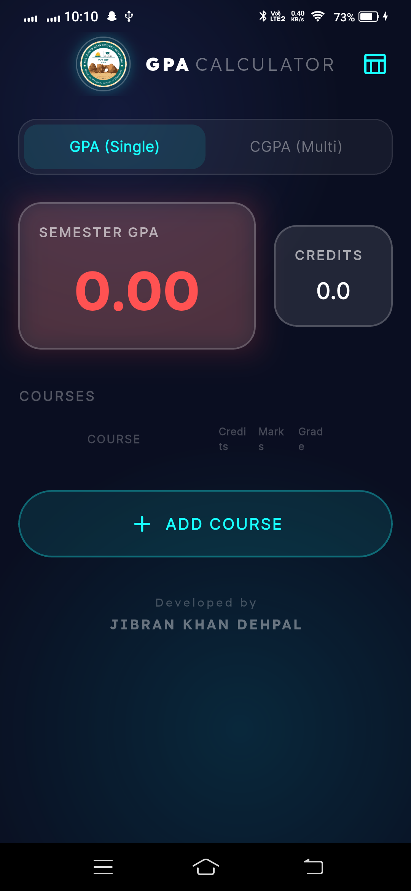
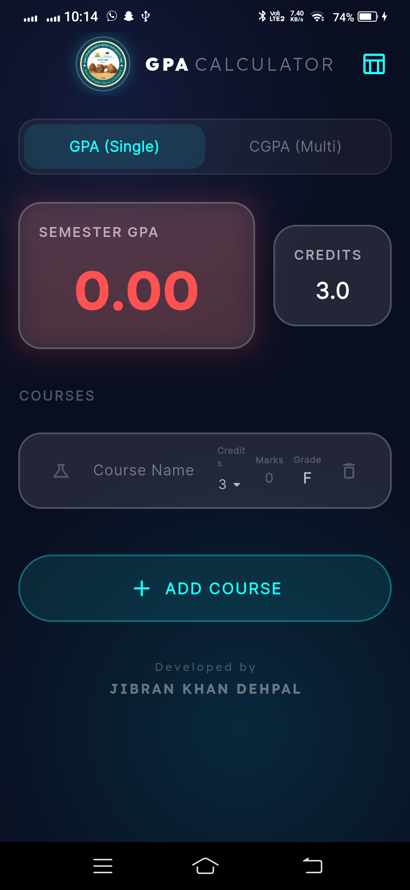
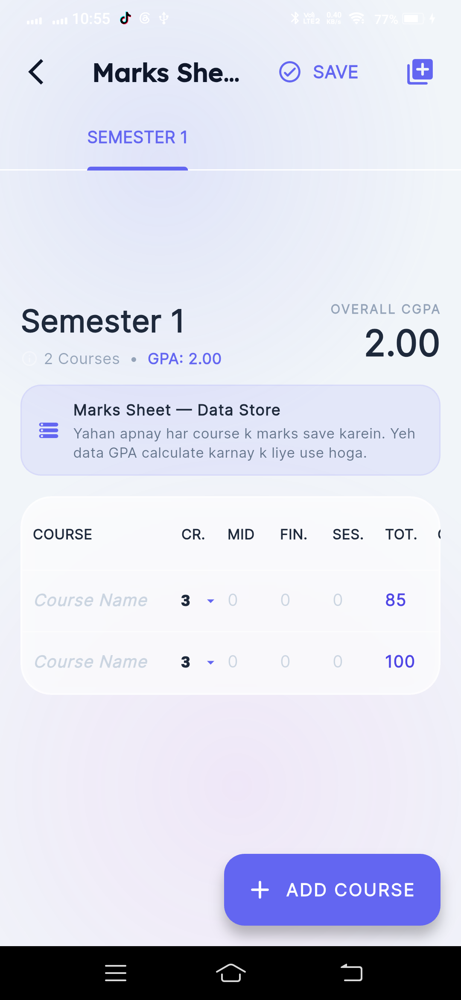

# MCKRU CGPA Calculator

<p align="center">
  
</p>

<p align="center">
  <strong>A modern, offline-first Flutter application for university students to calculate GPA and CGPA</strong>
</p>

<p align="center">
  
  
  
  
  
</p>

---

## Overview

MCKRU CGPA Calculator is a feature-rich mobile application built with Flutter that helps university students track and compute their academic performance. The app supports two calculation modes, a detailed marks sheet with auto-grade computation, and persists all data locally with zero network dependency.

**Developer:** Jibran Khan Dehpal  
**Package:** `com.jibrankhan.cgpacalculator`  
**Version:** 1.0.3+5

---

## Key Features

### Dual Calculation Modes
- **GPA (Single) Mode** — Enter individual courses with credit hours and marks. The app auto-converts marks to letter grades and computes semester GPA in real-time.
- **CGPA (Multi) Mode** — Enter multiple semesters with their GPAs and credit hours to compute cumulative CGPA.

### Marks Sheet
- Full data-entry table per semester with columns for Course Name, Credit Hours, Mid, Final, Sessional, Total, and Grade.
- **Auto-calculation:** Mid + Final + Sessional = Total; Total auto-derives the Letter Grade.
- Tabbed semester navigation with add/delete capabilities.

### Smart Marks-to-Grade Conversion
10-grade scale with support for practical/lab courses:

| Grade | Points | Min Marks |
|-------|--------|-----------|
| A | 4.0 | 85 |
| A- | 3.7 | 80 |
| B+ | 3.3 | 75 |
| B | 3.0 | 70 |
| B- | 2.7 | 65 |
| C+ | 2.3 | 61 |
| C | 2.0 | 58 |
| C- | 1.7 | 55 |
| D | 1.0 | 50 |
| F | 0.0 | < 50 |

- **Lab/Practical toggle** — Doubles marks for grade calculation, simulating a 50-mark scale.

### Real-time Stats Dashboard (Bento Grid)
- Color-coded CGPA display: Green (>= 3.5), Amber (>= 2.5), Red (< 2.5)
- Total credits tracking
- Updates instantly as data changes

### Local-First Persistence
- All data saved via `SharedPreferences` as JSON
- Three independent storage stores for main data, CGPA results, and marks sheet
- Full offline support — zero network calls

---

## Architecture & Tech Stack

### Project Structure

```
lib/
├── main.dart                    # App entry point
├── models/
│   ├── course.dart              # Course data model
│   ├── semester.dart            # Semester model (holds courses)
│   └── semester_result.dart     # Semester result model (GPA + credits)
├── providers/
│   └── semester_provider.dart   # Riverpod state management
├── screens/
│   ├── home_screen.dart         # Main calculator screen
│   └── marks_sheet_screen.dart  # Detailed marks entry screen
├── services/
│   └── gpa_service.dart         # Grade/marks conversion logic
├── theme/
│   └── app_theme.dart           # Dark theme configuration
└── widgets/
    ├── bento_card.dart          # Stats summary card
    ├── course_row.dart          # Course input row
    ├── glass_card.dart          # Glassmorphism card
    ├── mesh_gradient_background.dart  # Gradient background
    ├── neomorphic_button.dart   # Styled button
    ├── semester_row.dart        # Semester input row
    └── semester_selector.dart   # Semester chip selector
```

### State Management — Riverpod

| Provider | Purpose |
|----------|---------|
| `semesterProvider` | Main GPA/CGPA state with courses and mode |
| `cgpaProvider` | Multi-semester CGPA results |
| `marksSheetProvider` | Independent marks sheet state |
| `gpaStatsProvider` | Derived real-time stats (computed) |
| `marksStatsProvider` | Derived marks sheet stats |

### Design Patterns
- **Immutable State** — All models use `copyWith` for state updates
- **Provider Pattern** — Clean separation of UI and business logic
- **JSON Serialization** — Full `toJson()` / `fromJson()` on all models
- **Component-Based UI** — Reusable widgets (`GlassCard`, `BentoCard`, etc.)

### Dependencies

| Package | Purpose |
|---------|---------|
| `flutter_riverpod` | State management |
| `google_fonts` | Lexend & Inter font families |
| `flutter_animate` | Declarative animations |
| `shared_preferences` | Local persistence |
| `uuid` | Unique ID generation |

---

## UI/UX Design

### Theme
- **Material 3** dark theme with cyan primary and indigo secondary
- **Fonts:** Lexend (headings) + Inter (body) via Google Fonts
- **Background:** Mesh gradient with indigo and violet radial glows

### Visual Effects
- **Glassmorphism** — Frosted glass cards with backdrop blur and subtle borders
- **Neomorphism** — Glowing indigo buttons with shadow effects
- **Mesh Gradient** — Multi-layered radial gradient background
- **Haptic Feedback** — Tactile responses on interactions (medium, light, heavy impact)

### Color Coding
| Color | Meaning |
|-------|---------|
| Emerald (Green) | GPA >= 3.5 — Excellent |
| Amber | GPA >= 2.5 — Good |
| Red | GPA < 2.5 — Needs Improvement |

---

## How It Works

### GPA Mode Flow
1. Select "GPA (Single)" mode
2. Add courses with name, credit hours (1-6), and total marks (0-100)
3. Marks auto-convert to letter grades using the 10-grade scale
4. Semester GPA calculated as: `Σ(grade_points × credits) / Σ(credits)`
5. Overall CGPA computed across all semesters

### CGPA Mode Flow
1. Select "CGPA (Multi)" mode
2. Add semesters with name, credit hours, and GPA (0.0-4.0)
3. CGPA computed as simple average of all semester GPAs

### Marks Sheet Flow
1. Navigate to Marks Sheet from the home screen
2. Enter per-course marks: Mid, Final, Sessional
3. Total auto-sums; Grade auto-derives
4. Add/delete semesters and courses as needed

---

## Platform Support

| Platform | Status |
|----------|--------|
| Android | Signed release build configured |
| Windows | MSIX package configured |
| Web | Supported |
| iOS | Platform files present |

---

## Performance Optimizations

- `RepaintBoundary` on gradient background and stats grid
- Backdrop blur disabled on static cards
- Focus-node based input updates (not per-keystroke)
- Input values clamped at both widget and provider levels

---

## Privacy

- **100% Offline** — No internet permission required
- **No Data Collection** — Zero analytics, zero tracking
- **Local Storage Only** — All data stays on device via SharedPreferences

---

## Screenshots

<p align="center">
  
  
  
  
  
</p>

---

## Getting Started

```bash
# Clone the repository
git clone https://github.com/your-username/cgpa_calculator.git

# Navigate to project directory
cd cgpa_calculator

# Install dependencies
flutter pub get

# Run the app
flutter run
```

---

## Author

**Jibran Khan Dehpal**  
Email: jibrankhandehpal@gmail.com

---

> Built with Flutter, Riverpod, and a passion for clean UI/UX design.
